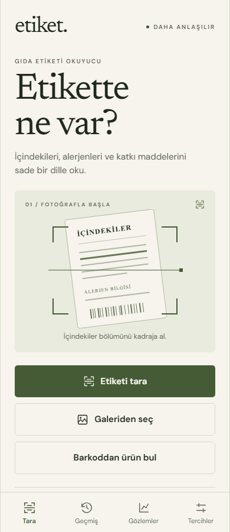
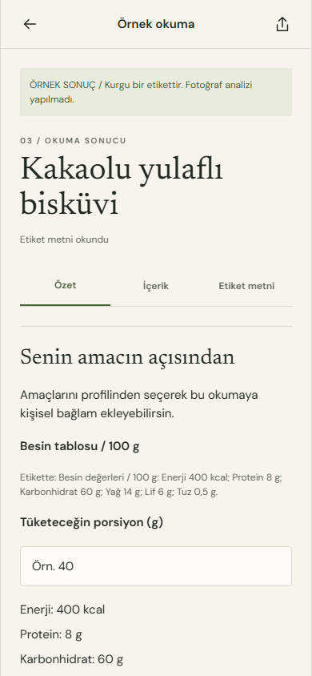

> Güncel demo ayarı: `npm run api` Gemini 3.8 Flash + Claude Sonnet 5.5 kullanır. Ekonomik sunucu `npm run api:economy`. Yerel profil yorumu API çağırmaz; model yorumu ayrı bulut düğmesidir. Maliyetler docs/INVESTOR_COSTS.md içinde.

# Etiket

Gıda etiketi fotoğrafını okuyup içerik, alerjen ve katkı maddelerini Türkçe açıklayan Android öncelikli React Native uygulama.

My GutIQ araştırması sonrasında menü/tabak incelemesi, barkod kataloğu, tüketim teyidi ve öğün sonrası kontrol, 7/30 günlük yerel gözlemler, restoran kartı ve PDF/metin raporu eklendi. Araştırma ve parite sınırları [GUTIQ_RESEARCH.md](docs/GUTIQ_RESEARCH.md), ekonomik senaryolar [INVESTOR_COSTS.md](docs/INVESTOR_COSTS.md) içinde. Gerçek model, OAuth, native PDF/barkod kamerası ve APK kabulü dış yapılandırma/cihaz bekler.

Kamera veya galeri → yerel önizleme → açık gönderim işlemi → kanıt metinleriyle açıklama.
Her alerjen beyanı **içerir** veya **eser miktarda içerebilir** olarak ayrılır. Sağlık puanı ve tüketim güvenliği garantisi üretilmez.

 

## Çalıştırma

Node.js 24 LTS ve Android telefonda Expo Go yeterlidir. Android Studio zorunlu değildir.

```powershell
npm ci
Copy-Item .env.example .env
```

`.env` içinde `GEMINI_API_KEY` değerini kendi sunucu anahtarınla doldur. Bu dosya git'e dahil edilmez.
`EXPO_PUBLIC_API_URL` yalnız sunucu adresidir; buraya veya başka bir `EXPO_PUBLIC_` değişkenine API anahtarı koyma.

İki ayrı terminal:

```powershell
npm run api
```

```powershell
npm start
```

Telefonda Expo Go ile terminaldeki QR kodunu aç. Telefon ve bilgisayar aynı ağda olmalı.
Fiziksel telefonda `.env` içindeki `EXPO_PUBLIC_API_URL` için bilgisayarın LAN IP adresini kullan:
`http://192.168.1.10:8787` bir örnektir; kendi IP adresinle değiştir.
`EXPO_PUBLIC_API_URL` hiç tanımlanmazsa development modunda Expo'nun LAN adresi otomatik kullanılır.
Uygulamada **Tercihler → Okuma hizmeti bağlantısı** üzerinden de adresi değiştirebilirsin.
Windows güvenlik duvarında Node bağlantısına yalnız özel ağda izin ver. Ortak Wi-Fi istemcileri birbirinden yalıtabilir.

Web önizleme:

```powershell
npm run web
```

Örnek sonucu anahtarsız ve çevrimdışı inceleyebilirsin. Örnek kurgu olduğu her ekranda belirtilir.
Gerçek fotoğraf gönderiminde anahtar yoksa yapılandırma hatası gösterilir; sahte analiz yapılmaz.

## Google hesabıyla kayıt / giriş

İlk ekranda Google hesabıyla devam veya hesapsız deneme bulunur. Sunucu imza/audience/süre doğrulaması yapıp uygulama oturumu oluşturur; Gmail kutusu okunmaz. Kurulum: [Google auth rehberi](docs/GOOGLE_AUTH.md). OAuth kimlikleri sağlanmadığı için gerçek Google giriş kabulü henüz yapılmadı. Google native girişi Expo Go içinde çalışmaz; APK veya development build gerekir. Profil, günlük, geçmiş ve alerjen tercihleri hesaplara göre ayrı tutulur.

## Kişisel kullanım profili

İlk açılışta altı adımlı amaç, yakınma, bildirilen tanı/şüphe, rutin ve koşullu takip soruları akışı vardır. Atlanabilir ve sonradan düzenlenebilir. Profil/günlük native cihazda AES-256-GCM ile şifrelenir; web önizlemesinde yalnız sekme oturumunda tutulur.

Kişisel yorum ve soru sıralama için sunucu `.env` dosyasına `ANTHROPIC_API_KEY` ekle. Demo varsayılanı `PERSONAL_MODEL=claude-sonnet-5-5`; bütçe alternatifi `claude-sonnet-5-5`. Kullanıcı aktarım iznini açmadan sağlık verisi modele gönderilmez. Anahtar yokken yerel profil, günlük ve porsiyon hesabı kullanılabilir; model yorumu yerine sahte yanıt gösterilmez.

Besin tablosu için önizlemede ikinci fotoğraf eklenebilir. Sonuçta porsiyon miktarı girilince görünen kalori/makro değerleri kodla ölçeklenir; eksik mikrobesin tahmin edilmez.

[Yatırımcı maliyet senaryoları](docs/INVESTOR_COSTS.md) ve [model seçimi](docs/MODEL_SELECTION.md) günceldir. `npm run costs` hesapları tekrar üretir.

## İçerik

- Gerçek kamera ekranı, fener, sistem galeri seçicisi, JPEG küçültme ve fotoğraf önizlemesi.
- Gemini Flash Vision, tek istek ve doğrulanmış JSON sözleşmesi.
- Sade özet, içerik açıklamaları, katkı işlevleri ve birebir etiket kanıtları.
- İsteğe bağlı 14 alerjen tercihi ve kişisel eşleşme vurgusu; tercihler modele gönderilmez.
- Son 50 metin okuması cihazda; Türkçe arama, tekil/tam silme ve paylaşma.
- Gizlilik ve kullanım koşulları; işletmeci bilgileri eksik olduğundan hukuki metinler taslaktır.
- API token koruması, istek sınırı, boyut kontrolü, timeout ve istemci iptali.

## Doğrulama

```powershell
npm run lint
npm run typecheck
npm test
npm run build
npm run build:api
npm run test:api-bundle
npx playwright install chromium
npm run test:e2e
npx expo-doctor
```

`build`, Android/iOS/web JavaScript ve Hermes paketlerini üretir. İmzalı APK veya mağaza paketi değildir.
Tarayıcı testlerinde sağlayıcı yanıtları test dublörüyle doğrulanır; canlı Vision kalitesi ölçülmüş sayılmaz.
Gerçek test sonuçları ve sınırlar: [doğrulama raporu](docs/VERIFICATION.md).

## APK ve sunucu yayını

Android Studio olmadan EAS bulut APK profili `eas.json` içinde hazırlanmıştır.
EAS hesabı/proje bağlantısı ve gerçek HTTPS API adresi gerekir. Komutlar ve kabul adımları:
[yayın rehberi](docs/RELEASE_RUNBOOK.md).

## Projede devam etme

Claude Code veya başka bir geliştirme oturumunda önce [CLAUDE.md](CLAUDE.md), [AGENTS.md](AGENTS.md)
ve [aktif bağlam](docs/ACTIVE_CONTEXT.md) okunur. [Faz planı](docs/MASTER_PLAN.md),
[faz durumları](docs/PHASE_STATUS.md), [AI rehberi](docs/AI_GUIDELINES.md),
[AI Slop rehberi](docs/AI_SLOP_AVOIDANCE.md) ve [rakip araştırması](docs/COMPETITOR_RESEARCH.md) ayrı tutulur.

Tarayıcı kabulü `npm run test:e2e` ile önce web export üretir, sonra 8082 üzerinde statik önizlemeyi açar. Aynı çıktı klasöründe eşzamanlı iki Playwright çalıştırması başlatma.

Ekonomik alternatif: Gemini 3.1 Flash-Lite fotoğraf okuma, API çağrısız yerel profil değerlendirmesi ve isteğe bağlı Haiku bulut ayrıntısı. Eski premium gider rakamları varsayılan değildir; INVESTOR_COSTS.md esas alınır.
